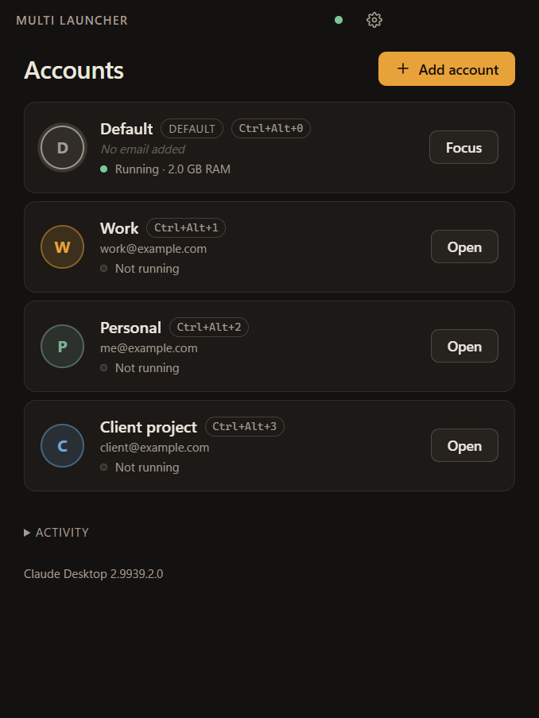
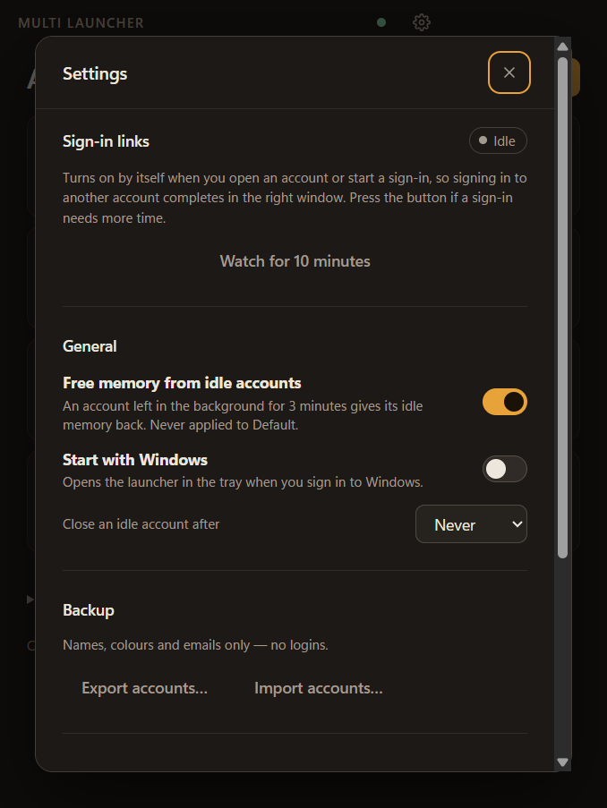

# Claude Multi Launcher

**Run several Claude Desktop accounts side by side on Windows and Linux.** Each account gets its own isolated Claude window with
its own login, so personal, work and client accounts stay signed in together instead of taking turns.

[](https://github.com/SumantSagar73/claude-multi-launcher/actions/workflows/ci.yml)
[](https://github.com/SumantSagar73/claude-multi-launcher/releases/latest)
[](LICENSE)


<p align="center">
  
  &nbsp;
  
</p>

## Why

Claude Desktop signs in to one account at a time. Switching means signing out, signing in, and losing your
place. This launcher starts each account in its own copy of Claude with a separate data folder, and takes care of the
awkward parts: getting a browser sign-in back to the right window, telling the windows apart, and keeping memory in
check.

## Features

- **Separate accounts, side by side.** Logins, chats and settings never mix. Your normal Claude stays as the *Default*
  account and is never modified.
- **Sign-in that lands in the right window.** Signing in to a second account in the browser hands the result to the
  window that asked for it, not to your default Claude.
- **Windows you can tell apart.** On Windows every extra account gets its own taskbar button, a coloured icon with its
  initial and a `[Name]` title prefix. On Linux each account gets its own dock icon and app-menu entry
  (`Claude (Name)`) in its colour.
- **Fast switching.** `Ctrl+Alt+0` to `Ctrl+Alt+9` open or focus an account from anywhere. Make a Start Menu shortcut
  (Linux: an app-menu entry) for any account. Tile several account windows on screen with one click.
- **Easy on memory (Windows).** Accounts left in the background give their idle memory back (about 1.6 GB down to about
  0.2 GB in testing). Optionally close an account after it has been idle for a set number of hours.
- **Know what each account costs.** Per-account RAM and disk use, including the large Cowork VM image.
- **Set up new accounts faster.** Copy another account's MCP server settings into a new one when you add it.
- **Backup and diagnostics.** Export and import your account list (names, colours and emails only, no logins), a health
  check, and a one-click "copy diagnostics" for bug reports.

## Requirements

**Windows**
- Windows 10 or 11, 64-bit.
- **Claude Desktop installed from the Microsoft Store** (the app named "Claude"). The launcher finds it automatically
  and follows its updates.

**Linux** (beta)
- Ubuntu 22.04 or later, or Debian 12 or later, x86_64, with **Anthropic's official Claude Desktop** installed from its
  apt repository (`sudo apt install claude-desktop`, see
  [Claude Desktop on Linux](https://code.claude.com/docs/en/desktop-linux)). This is the one that works with local
  folders and Claude Code. Other distributions work if `claude-desktop` is on your `PATH`; if it lives somewhere
  unusual, set `CML_CLAUDE_PATH` to the executable.
- Or the community snap **claude-ai-desktop** ("Desktop for Claude (Unofficial)", `sudo snap install claude-ai-desktop`), an
  unofficial wrapper around claude.ai that is not made by Anthropic. It is only the website in a window: no local
  folders, no Claude Code. The launcher uses it only when the official package is not installed. Its sandbox only
  allows account folders under `~/snap/claude-ai-desktop/`, so new accounts are stored in
  `~/snap/claude-ai-desktop/common/multi-launcher/`. It has no `claude://` sign-in step (logins happen inside its
  window), so the sign-in routing does nothing for it.
- For tiling and idle-close: an X11 session and `xdotool` (`sudo apt install xdotool`). Neither works on Wayland, and
  the launcher turns them off there instead of half working. See [Linux differences](#linux-differences).

## Install

1. Download the latest files from the [**Releases**](https://github.com/SumantSagar73/claude-multi-launcher/releases/latest) page.
2. Pick one:
   - `Claude-Multi-Launcher-<version>.exe` is a one-click installer. It installs for your user only and needs no admin
     rights.
   - `Claude-Multi-Launcher-<version>.zip` is a portable copy. Unzip it anywhere and run `Claude Multi Launcher.exe`.
3. Run it. The launcher lives in the system tray; closing its window just hides it.

**Windows SmartScreen.** The downloads are not code-signed (that needs a paid certificate), so Windows may show
"Windows protected your PC". Choose **More info**, then **Run anyway**. Each release lists a SHA-256 checksum
(`SHA256SUMS.txt`) so you can check you have the exact file that was published:

```powershell
Get-FileHash .\Claude-Multi-Launcher-<version>.exe -Algorithm SHA256
```

Uninstall from **Settings > Apps**. Your accounts are kept (in `%APPDATA%\Claude Multi Launcher`) so a reinstall picks
them up again, and your normal Claude data is never touched.

### Install on Linux

Linux packages are built by the release workflow when a version is tagged. If the
[**Releases**](https://github.com/SumantSagar73/claude-multi-launcher/releases/latest) page does not list them yet,
build from source (below). When they are there, pick one:

- `Claude-Multi-Launcher-<version>-linux-x64.AppImage`: make it executable (`chmod +x`) and run it.
- `Claude-Multi-Launcher-<version>-linux-x64.deb`: `sudo apt install ./Claude-Multi-Launcher-<version>-linux-x64.deb`.
- `Claude-Multi-Launcher-<version>-linux-x64.tar.gz`: unpack anywhere and run `Claude Multi Launcher`. If it will not
  start and prints a sandbox error, start it with `--no-sandbox` (see [Troubleshooting](#troubleshooting)).

Or build and install for your user only, with no sudo (see [Build from source](#build-from-source)):

```bash
npm install
npm run package:linux
npm run install-app:linux      # adds ~/.local/bin/claude-multi-launcher and an app-menu entry
```

The launcher lives in the system tray (on GNOME it needs the AppIndicator extension). Your accounts are kept in
`~/.config/Claude Multi Launcher`, and your normal Claude data in `~/.config/Claude` is never touched.
`npm run uninstall-app:linux` removes what the install script added.

## Quick start

1. Click **Add account**, give it a name and a colour. The email is an optional label to help you remember which
   account is which.
2. Click **Open**. A fresh Claude window appears with its own, empty login.
3. Sign in inside that window (Google, email or SSO). In the browser, sign in as the account you want. A browser
   profile that is already signed in as that account, or a private window, works well.
4. When the browser finishes, your Default Claude may flash for a moment and ignore the link. The launcher passes it to
   the new window, which finishes signing in. **Settings > Sign-in links** and the *Activity* list show what happened.
5. **Linux:** turn on **Settings > Catch sign-in links** once. It makes the launcher the app that receives `claude://`
   links, which is the dependable way to get each sign-in to the right account. If your browser asks which app to open
   the link with, choose *Claude Multi Launcher (sign-in links)*.

Google (and other) sign-in uses whichever account your **browser** is signed in to. To sign a second Claude account in,
pick the right Google account in the browser, or use a private window or another browser profile. The launcher only
decides which Claude window receives the result.

## How sign-in routing works

Windows sends every `claude://` link to one app, and Claude's Store package always wins that. So when you finish a
browser sign-in for a second account, Windows starts Claude with the link, and it goes to your Default Claude, which
correctly refuses a sign-in it never started. The launcher watches for that short-lived process, reads the link off its
command line, and forwards it to the account that began the sign-in (found from that account's own log). No Windows
settings are changed. Details are in [docs/ARCHITECTURE.md](docs/ARCHITECTURE.md).

**On Linux** the same link goes to whatever program is registered for `claude://`, normally Claude Desktop itself. The
launcher can watch for it the same way (by polling `/proc`), but it works best as the registered handler: with
**Catch sign-in links** on, the system hands every `claude://` link to the launcher, which sends sign-ins to the account
that began them and everything else to your Default Claude. Claude Desktop re-registers itself each time it starts, so
the launcher takes the handler back a few seconds after you open an account. Turning the setting off puts the previous
handler back.

## Privacy and safety

- **Your Default Claude is never modified, closed, restyled or trimmed.** The launcher only reads which Claude
  processes are running and a line from its log.
- **No secrets.** It never reads or decrypts sign-in tokens or cookies. The email shown is a label you typed.
- **No network requests of its own and no telemetry.**
- **What it reads:** the process list and their command lines, Claude's own log files (to see which account opened a
  sign-in page), and, only when you ask, one settings file to copy MCP servers into a new account.
- **What it changes (Windows):** its own data under `%APPDATA%\Claude Multi Launcher`, the icon, title and taskbar
  identity of the windows it opened, and, only when you switch them on, a Start Menu shortcut or a "start with Windows"
  entry.
- **What it changes (Linux):** its own data under `~/.config/Claude Multi Launcher` (or `~/snap/…/common` for the snap),
  an app-menu entry per extra account in `~/.local/share/applications`, and, only when you switch them on, an
  autostart entry and the `claude://` link handler (the previous handler is remembered and put back).

The code is small and readable. See [SECURITY.md](SECURITY.md) to report a problem.

## Linux differences

The idea is the same: each account is a separate Claude Desktop started with its own `--user-data-dir`. What differs:

| | Windows | Linux |
| --- | --- | --- |
| Finding Claude | Store package lookup | `claude-desktop` on `PATH`, then the `.deb` install locations, then the community snap (or `CML_CLAUDE_PATH`) |
| Sign-in links | Watches new processes for the `claude://` link | The same, by polling `/proc`. Better: turn on **Settings > Catch sign-in links**, which makes the launcher the system's handler for `claude://` links (undone by switching it off), so no link is missed. |
| Telling windows apart | Own taskbar button, coloured icon, `[Name]` title | Each extra account gets its own window class and an app-menu entry `Claude (Name)` with a coloured icon (made when you open or edit the account), which the dock and task switcher group by. On Wayland the account is started through XWayland, because Wayland fixes a window's identity inside the app; set `CML_NATIVE_WAYLAND=1` to keep native Wayland (then all accounts look alike). Titles are not changed. |
| Shortcuts | Start Menu `.lnk` | A `.desktop` entry in `~/.local/share/applications` |
| Start with the system | Login item | `~/.config/autostart` entry |
| Free memory from idle accounts | Yes | **Not available.** There is no safe equivalent of trimming a working set without special privileges. |
| Tile windows, close idle accounts | Yes | X11 with `xdotool` only. They are switched off on Wayland, which does not let one program move or watch another's windows. |
| Hotkeys `Ctrl+Alt+0..9` | Yes | X11. Wayland compositors may refuse global shortcuts; the tray menu still works. |

## Limitations

- Windows (Microsoft Store version of Claude Desktop) and Debian-based Linux (the official `claude-desktop` package, or
  the community snap). The Linux support is new: it has been run on Ubuntu 24.04 (Wayland) and against a
  stand-in for Claude Desktop, not across many distributions and desktops. Please open an issue with
  **Settings > Copy diagnostics** if something is off.
- Each account that uses Cowork downloads its own VM image (about 8 GB). Sharing one between accounts is not
  attempted because two running VMs cannot safely share one writable disk.
- Freed memory is moved out of RAM, not capped. The first click after a long idle can be a little slower.
- Sign-in routing depends on how Claude Desktop behaves today. If a Claude update changes it, the health check and
  Activity list will show it. Please open an issue.
- `Ctrl+Alt+<n>` hotkeys are global; if another program already uses one, that slot will not fire.

## Troubleshooting

| Problem | What to try |
| --- | --- |
| A sign-in did not complete | Open **Settings > Sign-in links** and press *Watch for 10 minutes*, then sign in again. Check *Activity* for where the link went. |
| Windows asks "How do you want to open this?" for Claude links | **Settings > Health check** may show a leftover registration with a **Fix** button. |
| The launcher says Claude is not found | Windows: install Claude Desktop from the Microsoft Store. Linux: install `claude-desktop` (see Requirements), or set `CML_CLAUDE_PATH` to its executable. Then reopen the launcher. |
| Linux: the launcher will not start and mentions the sandbox | The `.tar.gz` and a user-level install cannot give Electron's helper the setuid bit, and Ubuntu 24.04 blocks the alternative. Start it with `--no-sandbox` (the install script already does). The launcher only shows its own local window, never web pages. The `.deb` and AppImage do not need this. |
| Linux: signing in to another account lands in the wrong window | Turn on **Settings > Catch sign-in links** and check *Activity* for where the link went. Accounts must be started by the launcher (not by hand) so it knows which is which. If your `claude-desktop` is a wrapper script that drops extra arguments, it must pass `"$@"` through. |
| Linux: the browser asks which app should open `claude://` links | Choose *Claude Multi Launcher (sign-in links)* (and tick "always" if offered). Choosing *Claude* sends the link to your Default account. |
| Every sign-in ends up in the same account | That is the browser's account choice, not the launcher's. Pick another Google account, or sign in from a private window or another browser profile. |
| Linux: all accounts share one dock icon | Quit the accounts and **Open** them again from the launcher: windows opened before the update keep their old identity. On Wayland the launcher starts accounts through XWayland to give them their own class (`CML_NATIVE_WAYLAND=1` turns that off). Log out and in once if the dock still shows a generic icon. |
| Something else | **Settings > Copy diagnostics**, then paste the result into a new issue. |

## Build from source

Needs Node.js 24 or newer.

```bash
git clone https://github.com/SumantSagar73/claude-multi-launcher.git
cd claude-multi-launcher
npm install
npm start          # run from source
npm test           # unit tests
npm run release    # build the installer and portable zip into release/ (Windows) or AppImage, deb and tar.gz (Linux)
```

On Linux `npm run package:linux` makes a runnable folder in `dist/`, and `npm run install-app:linux` installs it for your
user.

See [CONTRIBUTING.md](CONTRIBUTING.md) for how to work on it safely, and [CHANGELOG.md](CHANGELOG.md) for what changed.

## Disclaimer

This is an unofficial community project. It is not affiliated with, endorsed by or sponsored by Anthropic. "Claude" is
a trademark of Anthropic. Use it with your own accounts and in line with Anthropic's terms of service. It does not try
to bypass usage limits.

## License

[MIT](LICENSE)
